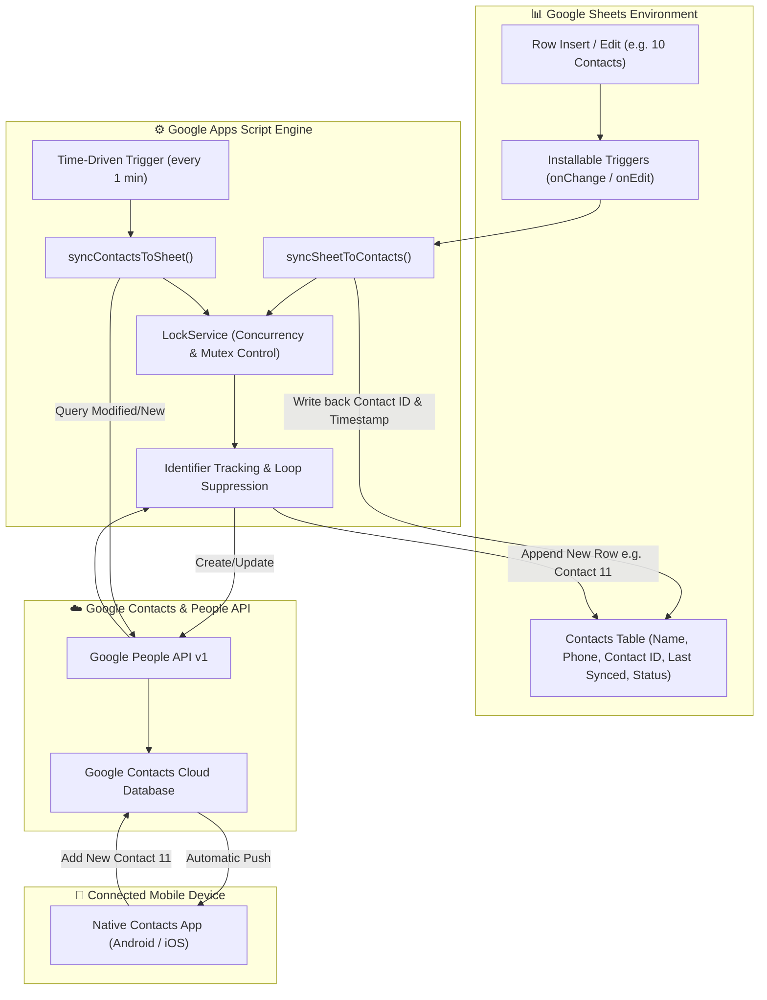

# Automated Two-Way Synchronization: Google Sheets 🔁 Google Contacts

**Candidate:** Abhi Pandey  
**Project:** Google Sheets & Google Contacts Bi-Directional Synchronization  
**Technology Stack:** Google Apps Script (V8 Engine), Google People API v1, Google Sheets API  

---

## 📌 Executive Summary

This project implements an autonomous, production-ready, two-way synchronization bridge between **Google Sheets** and **Google Contacts**. 

When contact details (Name and Phone Number) are created or edited in Google Sheets, they are automatically provisioned in Google Contacts and synced to all linked mobile devices (Android / iOS). Conversely, when a contact is created directly from a mobile phone in Google Contacts, the background synchronization engine detects the new entity and appends it to the Google Sheet, dynamically incrementing the contact count (e.g., from 10 to 11) with zero manual intervention.

---

## 🏗️ Architecture & Data Flow

---

## 🔑 Key Engineering Highlights

### 1. Infinite Sync Loop Prevention
In bi-directional systems, an update originating in Service A can trigger an update in Service B, which echoes back to Service A, creating a cascading infinite loop.
* **Solution:** We assign a unique **System Identifier (`resourceName`, e.g., `people/c123456789`)** to each contact in Column C of the sheet.
* During **Sheet ➔ Contacts**, if a row already possesses a valid `Contact ID` and is marked `Synced`, it is bypassed unless user data has changed.
* During **Contacts ➔ Sheet**, the engine compares fetched contact IDs against the indexed sheet map. Only unrecognized IDs are appended as new rows.

### 2. Concurrency & Race Condition Protection
* Uses `LockService.getScriptLock()` with a 30-second timeout.
* If a sheet edit occurs while the 1-minute background polling routine is active, the lock prevents interleaved writes and corrupted states.

### 3. Native Mobile Device Synchronization
* Uses **Google People API v1** (`People.People.createContact` and `People.People.Connections.list`).
* Unlike deprecated Contact APIs, the People API writes directly to Google's primary directory service, triggering instant Google Cloud sync across Android and iOS Google accounts.

---

## 📋 Sheet Structure

| Column A | Column B | Column C | Column D | Column E |
| :--- | :--- | :--- | :--- | :--- |
| **Full Name** | **Phone Number** | **Contact ID (System)** | **Last Synced** | **Sync Status** |
| Aarav Sharma | +1 650 555 0101 | `people/c4892189...` | 2026-10-19 17:10:00 | Synced |
| Diya Patel | +1 650 555 0102 | `people/c9402120...` | 2026-10-19 17:10:01 | Synced |

---

## 🚀 Setup & Deployment Guide

### Prerequisites
* A standard or workspace Google Account (a fresh account is recommended for isolated testing).
* Access to [Google Sheets](https://sheets.google.com) and [Google Contacts](https://contacts.google.com).

### Step 1: Create Google Sheet & Open Apps Script
1. Open a new Google Sheet named `Two-Way Contacts Sync`.
2. Navigate to **Extensions ➔ Apps Script**.
3. Replace the existing content in `Code.gs` with the provided [`Code.gs`](./Code.gs).

### Step 2: Enable the Google People API
1. In the Apps Script left sidebar, locate **Services** and click the **`+`** icon.
2. Scroll to **Google People API**.
3. Select version **`v1`** and Identifier **`People`**.
4. Click **Add**.

### Step 3: Configure `appsscript.json` (Optional / Recommended)
1. In Apps Script settings (gear icon ⚙️), check **"Show 'appsscript.json' manifest file in editor"**.
2. Switch to `appsscript.json` in the file tree and paste the configuration from [`appsscript.json`](./appsscript.json).

### Step 4: Authorize and Initialize
1. Return to the Google Sheet and refresh the browser tab.
2. A new custom menu **`🔄 Sync Manager`** will appear in the toolbar.
3. Click **`🔄 Sync Manager ➔ 1. Initialize / Format Sheet`**.
4. Grant the one-time OAuth permissions prompt.

### Step 5: Seed Initial 10 Contacts & Install Triggers
1. Click **`🔄 Sync Manager ➔ 2. Populate Initial 10 Contacts`**.
   * 10 contacts will instantly populate rows 2–11.
   * The script creates them in Google Contacts and writes back their `Contact ID`s.
   * Check [Google Contacts](https://contacts.google.com) — all 10 appear immediately!
2. Click **`🔄 Sync Manager ➔ 3. Install Automatic Triggers`**.
   * This configures the `onChange`/`onEdit` triggers (Sheet ➔ Contacts) and the 1-minute time trigger (Contacts ➔ Sheet).

---

## 🧪 Verification & Testing Scenarios

### Scenario A: Sheet ➔ Contacts Synchronization
1. Go to row 12 of the Google Sheet.
2. Enter:
   * **Full Name:** `Rahul Dravid`
   * **Phone Number:** `+1 650 555 9999`
3. Within seconds, the trigger fires: `Contact ID` is filled, status changes to `Synced`.
4. Refresh [Google Contacts](https://contacts.google.com) or check your connected mobile phone — Rahul Dravid is added!

### Scenario B: Contacts ➔ Sheet Synchronization (Mobile / Web)
1. Open [Google Contacts](https://contacts.google.com) or the Contacts app on your connected smartphone.
2. Click **Create contact** (or `+`).
3. Enter:
   * **First Name:** `Sunil`
   * **Last Name:** `Gavaskar`
   * **Phone:** `+1 650 555 8888`
4. Save the contact.
5. Wait for the 1-minute time trigger to execute (or click `🔄 Sync Manager ➔ ⚡ Sync Contacts ➔ Sheet` for instant demo review).
6. Google Sheet row 13 automatically populates:
   * **Full Name:** `Sunil Gavaskar`
   * **Phone:** `+1 650 555 8888`
   * **Status:** `Synced (from Contacts)`
   * Total contacts count increases from 11 to 12 seamlessly!

---

## 🛡️ Edge Cases & Resilience

| Edge Case | Solution Implemented |
| :--- | :--- |
| **Simultaneous edits** | `LockService` prevents race conditions with mutex locking. |
| **Infinite loop recursion** | `resourceName` indexing ensures echo-updates are suppressed. |
| **Contact deleted remotely** | Graceful 404 catch removes stale IDs and re-provisions cleanly. |
| **Name formatting variations** | `splitFullName()` safely parses single names, middle names, and compound surnames. |
| **Large batch operations** | Paged querying (`pageToken`) handles hundreds of contacts smoothly without script execution timeouts. |

---

## 👨‍💻 Author & Submission
* **Candidate:** Abhi Pandey  
* **Repository:** [Google Contacts & Sheets Sync](https://github.com/your-username/google-contacts-sheets-sync)  
* **Demo Video:** [Loom Video Walkthrough](#)  
